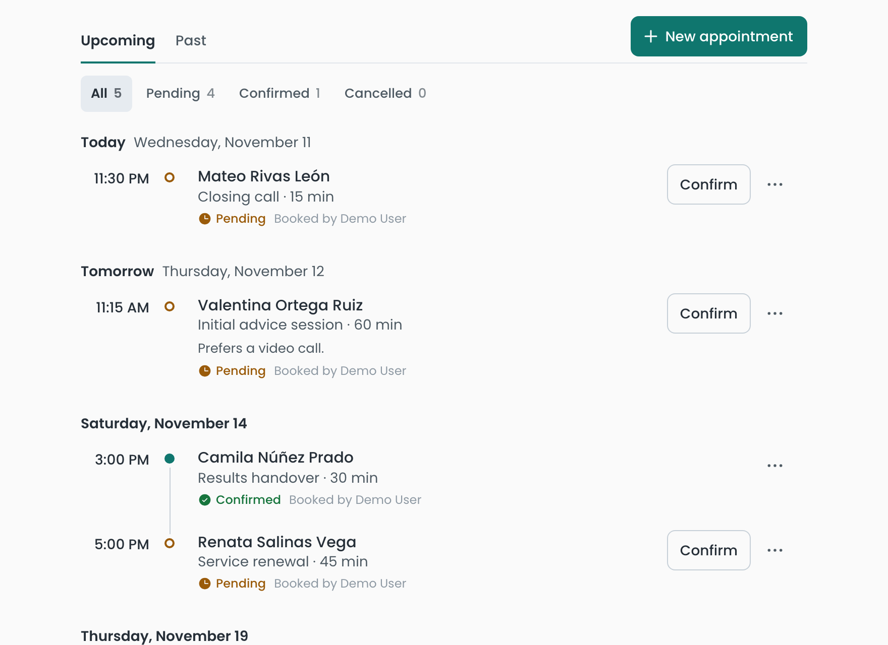
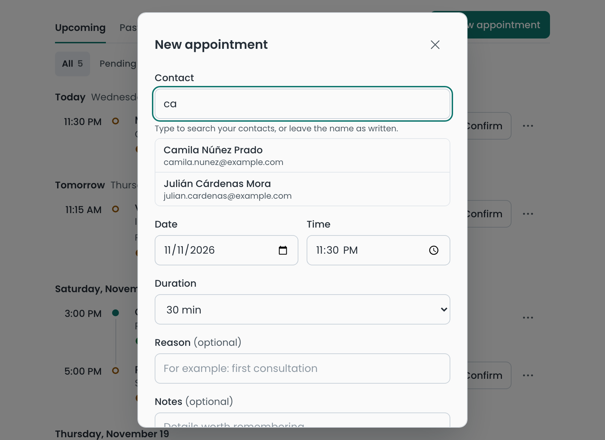
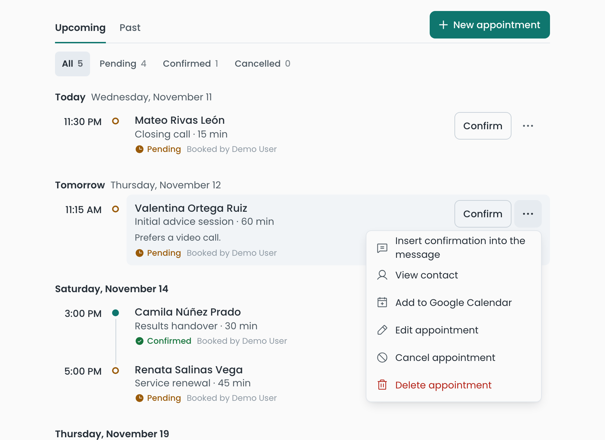
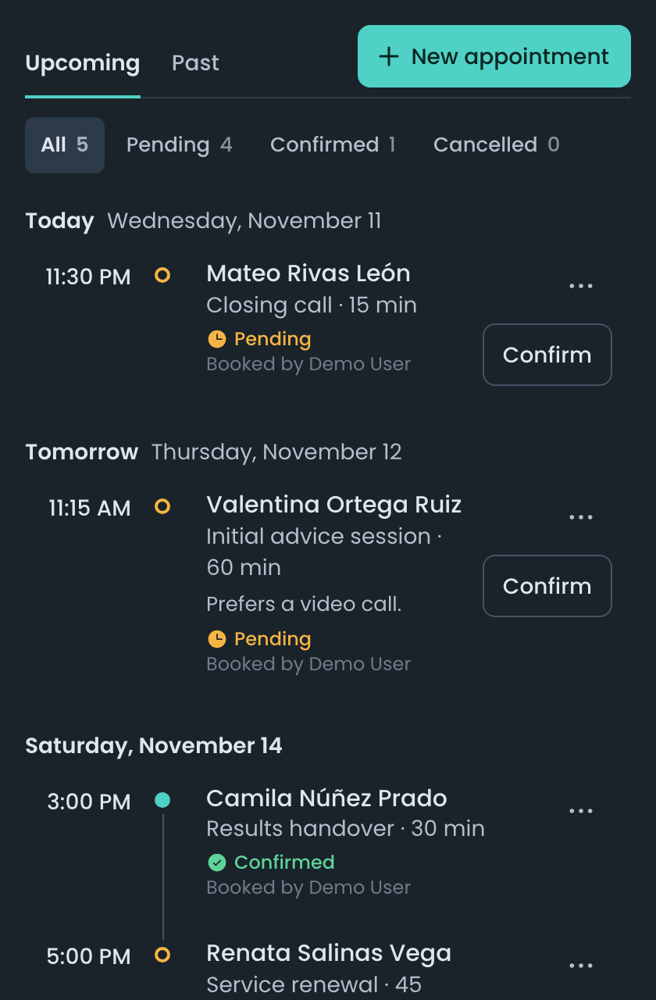
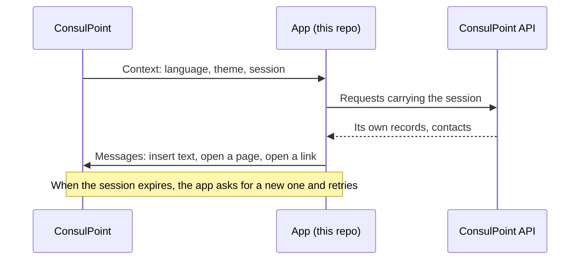

# ConsulPoint embedded app starter

[](https://github.com/akui-solutions/consul-point-app-starter/actions/workflows/ci.yml)
[](LICENSE)
[](https://github.com/akui-solutions/consul-point-app-starter/generate)

A small, complete sample of an embedded app for ConsulPoint, meant as a starting point.
It is an **appointment scheduler**: it books an appointment for a contact, confirms or cancels
it, and prepares the confirmation message for the conversation.

<picture>
  <source media="(prefers-color-scheme: dark)" srcset="docs/images/agenda-dark.png" />
  
</picture>

It is useful for two things:

- **Seeing how an app integrates** with ConsulPoint, in real, commented code.
- **Starting your own**: press **Use this template**, replace the sample feature with the one
  you need and keep the base.

## A quick look

| Booking, with contact suggestions                                                                                               | Actions with a name                                                                                                                                               | In a conversation's side panel                                                                                           |
| ------------------------------------------------------------------------------------------------------------------------------- | ----------------------------------------------------------------------------------------------------------------------------------------------------------------- | ------------------------------------------------------------------------------------------------------------------------ |
|  |  |  |

Every screenshot comes from demo mode: the people and appointments in them are invented.

## How it fits together



The app is a static site shown inside ConsulPoint. It never sees the user's own session: it
gets a short-lived one of its own, and everything it stores or reads goes through the API.

## See it in a minute

No account is needed. Demo mode works offline, with invented data that lives in memory until
the page reloads.

```bash
yarn install
yarn dev:mock
```

Open the address the terminal prints. To try the variants, add parameters to the address:
`?theme=dark`, `?language=en`.

It also works with `pnpm`. Requires Node.js 20 or later.

## What it shows

| What the app does                               | What it teaches                                                  | Where it lives                                                  |
| ----------------------------------------------- | ---------------------------------------------------------------- | --------------------------------------------------------------- |
| Opens in the user's language and theme          | Reading the context the platform hands over                      | `src/config/index.ts`, `src/App.tsx`                            |
| Records who booked each appointment             | Getting the user's verified identity                             | `src/services/session.ts`                                       |
| Saves, edits and deletes appointments           | Keeping records of its own in a data model                       | `src/services/modelApi.ts`, `MODELS.md`                         |
| Suggests contacts while booking                 | Reading the organization's data with a permission                | `src/services/contactsService.ts`                               |
| Books even without that permission              | Treating "no permission" as an unavailable feature, not an error | `hooks/useContacts.ts`, `components/ContactPicker.tsx`          |
| Keeps working past half an hour                 | Renewing the session without reloading                           | `src/services/api.ts`, `src/services/sessionRefresh.ts`         |
| Inserts the confirmation into the message       | Writing in the open conversation                                 | `src/services/parentSync.ts`, `features/appointments/index.tsx` |
| Opens the contact's page                        | Navigating to a screen of the platform                           | `src/services/parentSync.ts`                                    |
| Adds the appointment to an external calendar    | Opening a link in a new tab                                      | `components/AppointmentCard.tsx`                                |
| Warns when someone else changed the appointment | Handling simultaneous edits                                      | `hooks/useAppointments.ts`                                      |
| Never leaves the screen blank                   | Loading, empty, error, session-ended and no-context states       | `src/components/`                                               |

Paths starting with `hooks/` and `components/` are inside `src/features/appointments/`.

## Structure

```
src/
  config/        Platform context and demo mode
  services/      API calls, session, messages to the platform and invented data
  components/    Shared states: loading, empty, error
  i18n/          Common texts in Spanish and English
  styles/        Colors and fonts, light and dark
  features/
    appointments/   The sample feature: the part you replace with your own
```

## Commands

| Command         | What for                                                                                    |
| --------------- | ------------------------------------------------------------------------------------------- |
| `yarn dev:mock` | Offline demo, with invented data                                                            |
| `yarn dev`      | Development against a real environment (values in `.env.local`, copied from `.env.example`) |
| `yarn test`     | Tests                                                                                       |
| `yarn lint`     | Lint                                                                                        |
| `yarn format`   | Format the code with Prettier (`yarn format:check` only checks)                             |
| `yarn build`    | Type check and build                                                                        |
| `yarn package`  | Builds the `.zip` file that is uploaded to ConsulPoint                                      |

## Publishing it in ConsulPoint

1. Run `yarn package`. It writes `consul-point-app-starter.zip`, with `index.html` at its root.
2. In ConsulPoint, create an app of type **Extension** and upload the file as its first version.
3. In the **Models** tab, create the `appointment` model with the schema in [`MODELS.md`](MODELS.md).
4. In the **Permissions** tab, grant read access to **Contacts**. This is optional: without it
   the app works the same, and the person's name is typed by hand.
5. Open the app from the applications menu or from the side panel of a conversation.

Each step is covered in detail in the
[Aplicaciones integradas](https://docs.consulpoint.com/aplicaciones-integradas) section of the
ConsulPoint documentation (in Spanish).

## Making it your own

1. **Name.** Change `consul-point-app-starter` in `package.json` (the `name` field and the
   `.zip` name in the `package` script), the default id in `src/config/index.ts` and the title
   in `index.html`.
2. **Feature.** Replace `src/features/appointments/` with yours. Keep the shape: types, texts in
   `i18n/`, logic in `hooks/` and screen in `components/`.
3. **Data.** Define your models in `MODELS.md` and replace the invented data in
   `src/services/mockData.ts` and `src/services/mockApi.ts`.
4. **Look.** Colors and fonts are in `src/styles/tokens.css`; the font is loaded in
   `index.html`. The base borrows the platform's typeface, neutrals and corner radius so the
   app reads as part of it; change the accent before anything else.
5. **Messages to the platform.** In `src/services/parentSync.ts`, keep only the ones you use.

## Rules worth keeping

The base already follows them. Keep them in mind as you change it:

- **The context is read in one place**, `getConfig()`. No component reads
  `window.MINI_APP_PARAMS` directly.
- **Every API call goes through `sessionFetch`**, which adds the credentials and renews the
  session when it expires.
- **The session is never stored** in the browser, in the address or in the HTML, and never
  written to the console.
- **Browser storage is for interface preferences only.** Data that must be kept or protected
  is stored in the platform.
- **External links open through `openExternalUrl`**; inside the platform the app cannot open
  windows by itself.
- **Do not set `base` in `vite.config.ts`**, and use `HashRouter` if you add more screens: the
  app is served from a single address.
- **`sessionRefresh.ts` is used as is.** Its tests, and those of `parentSync.ts`, pin how the
  app talks to the platform: if a change breaks them, the change is the problem.
- **No header or reload button of its own.** The platform already shows the app's name and the
  reload action.
- **Every visible text exists in Spanish and English**, in the `i18n/` files.

A workflow in `.github/workflows/ci.yml` runs lint, format check, tests and build on every pull
request.

## License

[MIT](LICENSE).
